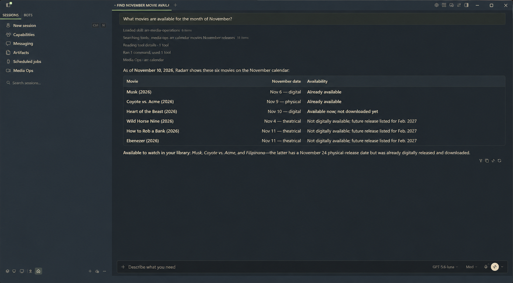
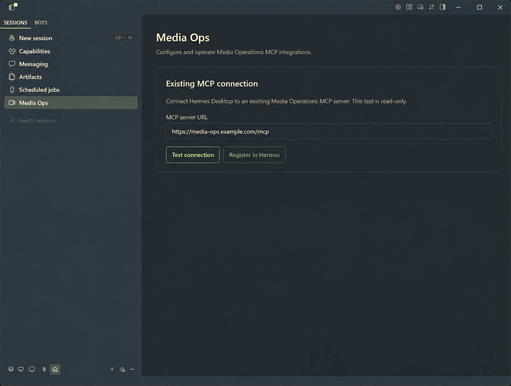
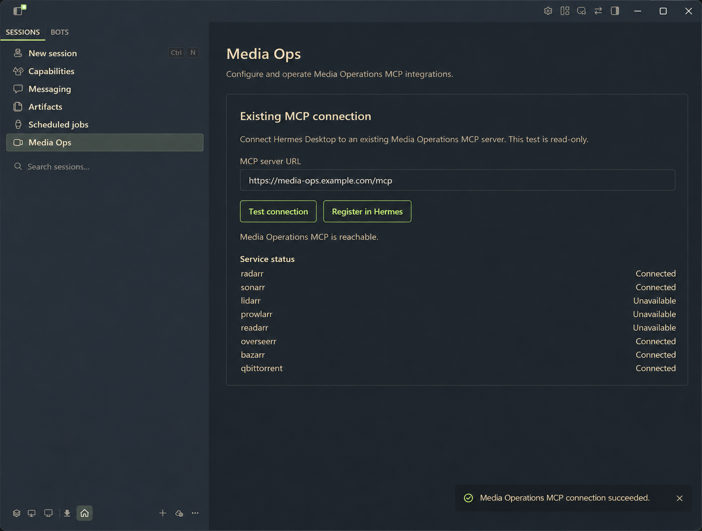

# Hermes Media Ops


> **Your media. One conversation.**
>
> Connect your media stack once. Ask Hermes for what you want.

Hermes Media Ops connects Hermes Desktop to an existing Media Operations MCP, making movies, shows, music, and books easier to manage through conversation. Ask what is available, explore choices that fit your preferences, and request the next step without juggling separate media applications.

The plugin connects and verifies. Your agent and MCP handle the media workflow.

## What can I do with it?

Once connected, you can ask Hermes questions such as:

- “What movies are available this month?”
- “What shows, albums, or books are already in my library?”
- “Why is this episode missing?”
- “Show me what is currently downloading.”
- “Explain the best release choices before I decide.”



*Ask Hermes in plain language and receive a structured, understandable answer.*

## What this plugin provides

- A dedicated **Media Ops** page in Hermes Desktop
- Persistent storage for the MCP endpoint
- A read-only connection and service-health check
- Clear visibility into which connected services are available
- Explicit, confirmation-gated registration in Hermes
- Registration read-back verification before reporting success

The plugin is the **setup and trust layer**. The MCP server supplies the media capabilities, and Hermes provides the natural-language interface.



*Registration remains disabled until the endpoint passes a read-only connection test.*



*Test the connection and see which parts of the media stack are available before using them through Hermes.*

## Installation and first use

### From the Hermes catalog

After this plugin is accepted into the Hermes Plugin Catalog, install it with:

```bash
hermes plugins install hermes-media-ops
```

The catalog installs the reviewed plugin at an exact commit. Until catalog acceptance, use the repository's `desktop/plugin.js` as a development installation according to the [Hermes Desktop plugin documentation](https://hermes-agent.nousresearch.com/docs/developer-guide/desktop-plugin-sdk).

### Connect your MCP

1. Start an existing Media Operations MCP endpoint.
2. Open **Media Ops** in the Hermes Desktop sidebar.
3. Enter the endpoint URL, normally ending in `/mcp`.
4. Select **Test connection**.
5. Review the read-only service status results.
6. Select **Register in Hermes** and confirm the configuration change.
7. Start a new Hermes session and ask a natural-language media question.

The endpoint must be reachable from the machine running Hermes Desktop and must expose the read-only `/api/health` check used by this plugin.

## How the pieces fit together


- **Hermes Media Ops plugin** — connects, tests, and verifies the endpoint
- **Media Operations MCP** — exposes media-management capabilities
- **Hermes Agent** — turns natural-language requests into understandable actions and explanations
- **Your services** — Radarr, Sonarr, Lidarr, Prowlarr, Readarr, Overseerr, Bazarr, qBittorrent, and other supported services

## Safety boundaries

The current plugin milestone is deliberately narrow:

- The connection test is read-only.
- Registration is a separate explicit action.
- Registration requires a successful test of the same endpoint.
- Hermes configuration changes are confirmed by the user.
- The plugin does not install Docker containers or change infrastructure.
- The plugin does not store service API keys or passwords.
- The plugin itself does not search, grab, delete, or modify media.

After registration, media search, request, download, and library operations come from the connected MCP and are carried out through Hermes according to the tools and approval controls available in that setup. The connection plugin does not silently trigger those operations.

## Requirements and current limitations

- Hermes Desktop with desktop plugin support
- An already-running Media Operations MCP endpoint
- An endpoint that exposes the read-only `/api/health` check
- Network reachability from Hermes Desktop to the MCP endpoint
- A deployment that permits the desktop origin when direct browser requests are used

This release focuses on connecting and verifying an existing remote HTTP MCP endpoint. Local stdio installation, Docker-managed deployment, generic MCP discovery, and infrastructure management are not part of the plugin. Those are separate deployment concerns.

## Companion backend

The companion public backend package is here:

<https://github.com/NeonPrimate/media-ops-mcp>

It is our sanitized Media Operations distribution built from the upstream `arr-mcp` project:

<https://github.com/sandraschi/arr-mcp>

## Development

The plugin is a single uncompiled ESM file. The catalog entrypoint is:

```text
desktop/plugin.js
```

Validate syntax with:

```bash
node --check desktop/plugin.js
```

## License

MIT. See [`LICENSE`](LICENSE).
